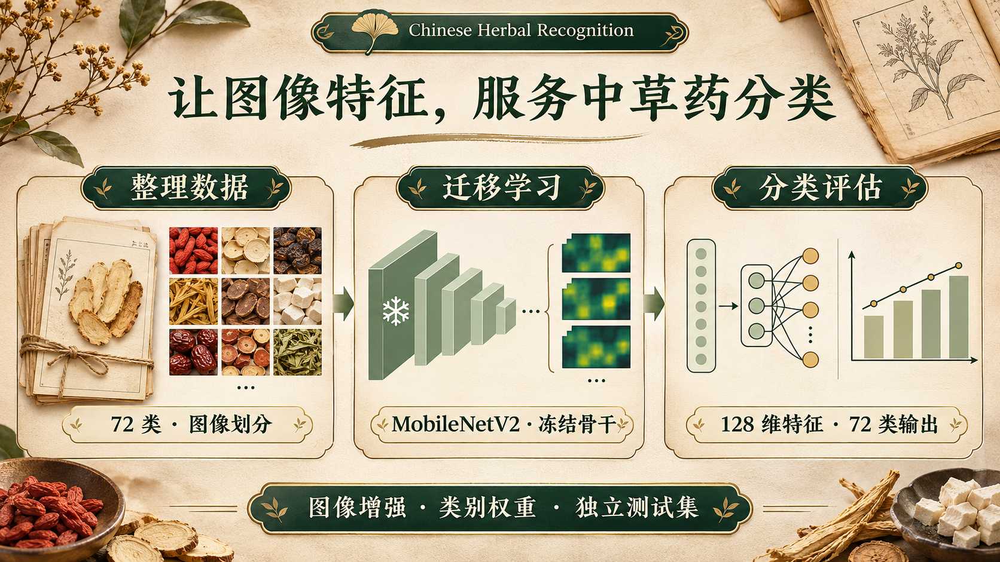
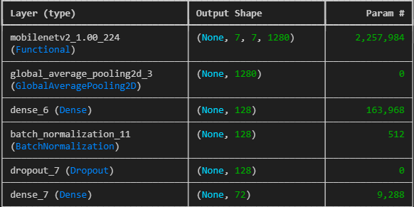
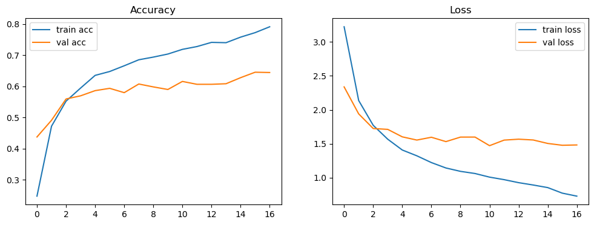

<div align="center">

# 中草药图像识别 · Chinese Herbal Recognition

### 用迁移学习，将 72 类中草药图像转化为可探索的分类任务。

**TensorFlow · MobileNetV2 · 图像增强 · 类别加权**

[](https://github.com/kayaduster607-jpg/chinese-herbal-recognition/actions/workflows/checks.yml)


[项目思路](#项目思路) · [历史运行记录](#历史运行记录) · [开始训练](#开始训练) · [数据集仓库](https://github.com/kayaduster607-jpg/chinese-herbal-dataset) · [⭐ Star](https://github.com/kayaduster607-jpg/chinese-herbal-recognition/stargazers)

</div>

中草药图像存在形态相似、拍摄角度不同和类别分布不均等挑战。本项目以 **72 类图片分类**为目标，采用 ImageNet 预训练的 MobileNetV2 提取视觉特征，结合数据增强、类别权重和验证集早停，构建可复现的训练与评估流程。



> 上图为项目流程插画；下方模型结构和曲线原样提取自项目提供的 Word 运行记录。

## 项目思路

| 阶段 | 实现 |
| --- | --- |
| 数据组织 | 按类别文件夹读取图片，逐类划分训练 / 验证 / 测试集 |
| 图像处理 | 224 × 224、像素缩放；训练集加入旋转、平移、水平翻转、缩放与亮度变化 |
| 特征提取 | 使用 ImageNet 预训练的 MobileNetV2，冻结骨干网络 |
| 分类头 | 全局平均池化 → Dense 128 → BatchNorm → Dropout → 72 类 Softmax |
| 训练控制 | 类别权重、学习率调整、验证损失早停与最佳权重恢复 |
| 结果留存 | 输出模型、类别索引、训练曲线数据和测试指标 |

图像处理中的 `rescale=1/255` 保留历史实验配置。MobileNetV2 常见的预训练预处理方式与其不同；对比不同预处理的效果需要重新实验。

## 历史运行记录

### 实际模型结构



### 实际训练曲线



Word 记录显示，该次 MobileNetV2 实验在早停后恢复第 11 轮的最佳权重，并报告**测试集准确率 62.35%**。这是用户提供的历史记录，不是本次重新训练的测量值；复现实验时，数据划分和结果可能不同。

### 保存模型的对应关系

本机发现的 `chinese_medicine_classifier_simple.h5` 是另一套 **150 × 150 输入的普通 CNN**，输出 72 维；它不是上图的 MobileNetV2 权重。该文件已实际加载并对一张测试图片执行前向推理，但原始 CNN 训练代码和类别索引尚未找到，不能把该次结果与 MobileNetV2 指标混用。

## 数据集

独立公开的 [中草药图像数据集](https://github.com/kayaduster607-jpg/chinese-herbal-dataset) 包含 **72 类、7,176 张 JPG 图片**。用户提供的原始目录有两张无法完整解码的白芍图像，公开副本中已排除；原盘内容保持不变。

数据仓库不包含固定划分。`train.py` 使用种子和排序后的文件名逐类生成 70% / 15% / 15% 划分，保存类别索引；因此它提供可复现的新划分，不保证与历史实验完全一致。

## 开始训练

在 Python 3.13 环境准备代码和数据：

```bash
git clone https://github.com/kayaduster607-jpg/chinese-herbal-recognition.git
git clone https://github.com/kayaduster607-jpg/chinese-herbal-dataset.git
cd chinese-herbal-recognition
python -m venv .venv
```

激活环境：

```powershell
# Windows PowerShell
.\.venv\Scripts\Activate.ps1
```

```bash
# macOS / Linux
source .venv/bin/activate
```

```bash
python -m pip install -r requirements.txt
python train.py --data-dir ../chinese-herbal-dataset/images --output-dir outputs/run-01
```

首次构建模型需要下载 ImageNet 预训练权重。默认 30 轮、批量 32、种子 42，可通过 `--epochs`、`--batch-size`、`--seed` 调整。输出目录下若已存在 `split/`，脚本会停止，避免旧图片混入新划分。

训练输出包括 `herbal_mobilenetv2.keras`、`class_indices.json`、`training_history.csv` 和 `evaluation.json`。输入图片会复制到本地 `split/`，请预留约两倍数据集大小的磁盘空间。

`original-experiment.ipynb` 保留原始 Notebook 作为历史参考，其中绝对路径需要按本机调整。新训练请使用上述入口。

## 验证与范围

- 已在 TensorFlow 2.20.0 / Keras 3.12.0 环境加载本机 CNN 权重，完成单张图片前向推理。
- 已验证新划分入口的可重复性、类别内无交叉和已有目录保护：`python -m unittest discover -s tests -v`。
- 历史 MobileNetV2 模型权重未在提供目录中找到，本次没有重新训练或独立复测历史准确率。
- 图像及标签可用于研究演示；模型输出不能代替专业药材鉴定、用药或食用判断。

## 项目结构

```text
train.py                       # 可配置的 MobileNetV2 训练入口
original-experiment.ipynb      # 保留的原始实验
requirements.txt               # 已核对环境的依赖版本
tests/                         # 数据划分回归
docs/images/                   # Word 历史运行截图与工作流插画
docs/VISUALS.md                # 图片来源和插画提示词
```

<div align="center">

如果这个项目对你的图像分类学习有帮助，欢迎点个 [⭐ Star](https://github.com/kayaduster607-jpg/chinese-herbal-recognition)。

</div>
